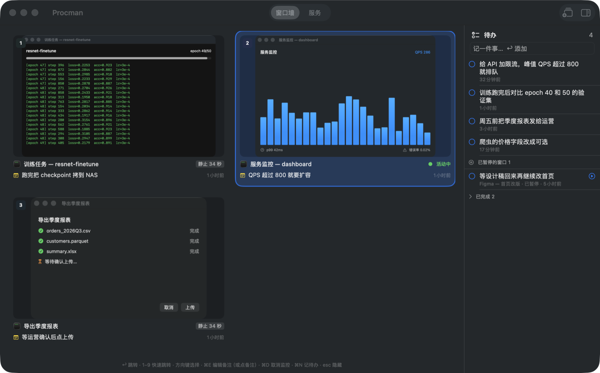
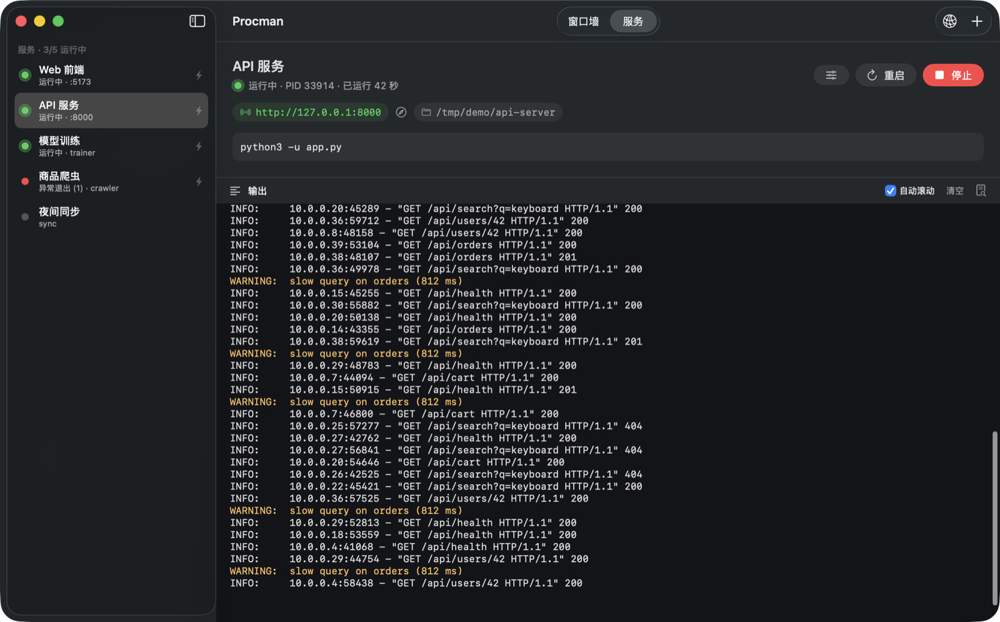
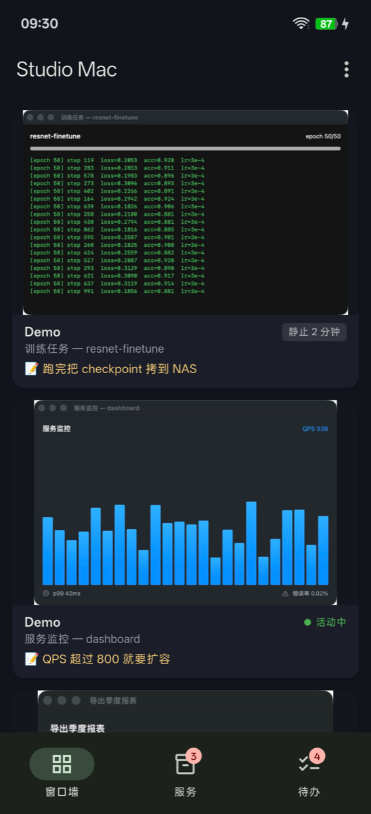
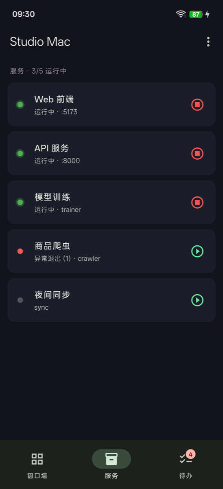
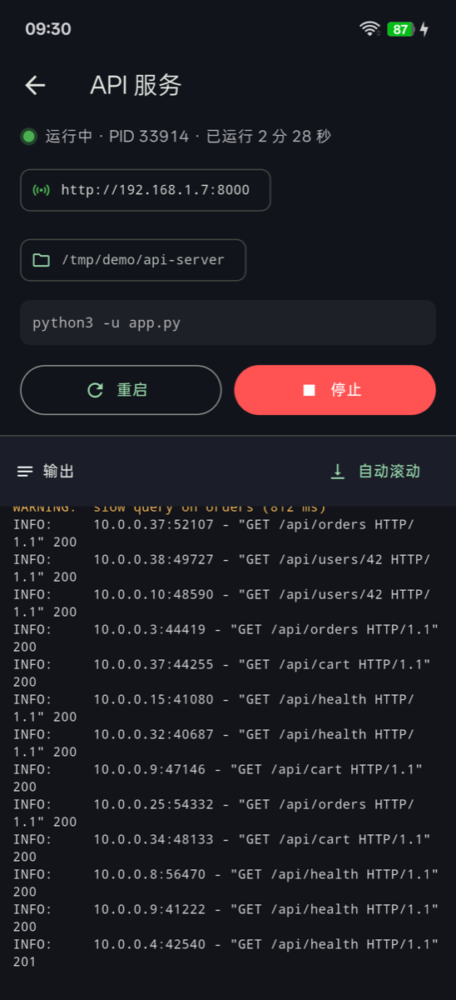
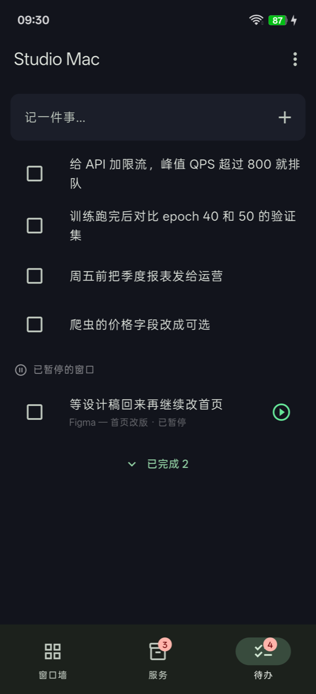

# Procman

一个住在 macOS 菜单栏里的小工具，把本地开发时那一堆「后台跑着的东西」和「正在等结果的事」管起来。

## 为什么做这个

现在干活常常是这样的：一个模型在训练，一个脚本在跑数据，两三个 AI 助手各自在不同窗口里写代码，终端里还开着前端和后端的服务。每件事都要等几分钟到几小时，于是你在它们之间来回切换。时间一长，就会出现这些情况：

- **忘了还有东西在跑**：某个服务昨天开的一直没关，端口被占，或者一个任务早跑完了却没人去看
- **不知道哪个好了**：十几个窗口挨个点开看，才发现「这个还在跑，那个半小时前就停了在等我回复」
- **丢了上下文**：切回某个窗口，想不起来刚才让它干什么、下一步要做什么
- **离开电脑就两眼一抹黑**：去开会、吃饭，不知道任务跑完没有、有没有报错

Procman 想解决的就是这些：

- 所有后台服务列在一处，**谁在跑、跑了多久、占着哪个端口、刚才输出了什么**一目了然，关掉 Procman 也不会把它们带走
- 正在等的窗口钉到一面墙上，缩略图实时更新，**「活动中」还是「静止 20 分钟」**一眼就能看出该去处理哪个
- 每个窗口可以写一句备注，比如「等训练跑完把模型拷走」，**切回来时马上知道自己在干什么**；暂时不管的就暂停成待办，不会占地方也不会忘
- 手机上也能看，**人不在电脑前也知道进度**，必要时直接重启服务

一句话：让你同时推进很多件事时，不用靠脑子记哪些在跑、哪些在等、每件做到了哪一步。

## 一览

- **服务**：给常驻命令（前端 dev server、API、训练脚本、爬虫……）配好目录和命令，一键启停、看实时输出，自动检测监听的端口
- **窗口墙**：把正在等结果的窗口钉到一面墙上，实时缩略图，告诉你哪个窗口「还在动」、哪个已经静止了多久
- **待办**：零散的事随手记；暂停监控的窗口、关掉的窗口也会变成待办，窗口重开时自动回到墙上
- **手机远程**：配套安卓 App，局域网内自动发现、连上，躺着也能看日志、启停服务、看窗口墙

<p align="center">
  
</p>

<p align="center">
  
</p>

<p align="center">
  
  
  
  
</p>

> 截图里的服务、窗口和待办都是演示数据。

## 功能

### 服务

- 每个服务 = 名称 + 启动目录 + 命令（zsh 执行，可多行；可选先 `source ~/.zshrc`，conda / nvm / pyenv 都能用）
- 启动、停止（整个进程组 SIGTERM，8 秒后 SIGKILL）、重启；可设置随 Procman 自动启动、异常退出自动重启（连续快速崩溃 5 次后停止）
- 输出直接写日志文件（`~/.procman/logs/<id>.log`，20 MB 轮转），Procman 退出或升级不影响服务，重新打开会自动接管
- 自动检测服务实际监听的端口并探测是不是 HTTP，一键复制 / 在浏览器打开
- 启动前发现端口被占用会提示占用进程，可以一键结束它再启动；「端口占用」窗口列出本机所有监听端口
- 菜单栏里直接启停，登录时可在后台启动

### 窗口墙

- 全局快捷键标记当前窗口（`⌃⌥M`）或整个 app（`⌃⌥⇧M`），可以写一句备注：「等训练跑完」「等运营确认后上传」
- 实时缩略图；后台也会定期截小图比对，标出「活动中」或「静止 x 分钟」——一眼看出哪个任务跑完了
- 点卡片跳到对应窗口（跨桌面也能跳），`1`–`9` 快速跳转，`⌃⌥W` 呼出 / 隐藏
- app 或 Mac 重启后窗口会换 ID，Procman 按标题 / 项目名自动找回标记
- **暂停监控**：右键「暂停监控（转为待办）」，窗口从墙上拿下来变成一条「已暂停」待办，点 ▶ 放回墙上
- **关掉的窗口**：写了备注的窗口关掉 20 秒后自动转为待办；窗口重新打开时自动回到墙上

### 待办

- 窗口墙右侧的待办栏，`⌃⌥N` 在任何地方快速记一条
- 勾选完成、原地编辑、拖动排序；已暂停的窗口单独一组

### 手机远程（安卓）

- Mac 上的 Procman 在局域网开一个 WebSocket 服务（默认端口 7788，被占用时自动换），并通过 Bonjour 广播 `_procman._tcp`
- 安卓 App 自动发现局域网里的 Procman；第一次连接时 Mac 上弹窗确认，之后自动连上、断线自动重连
- 手机上可以：看窗口墙缩略图和静止时长、点一下让 Mac 切到该窗口、暂停 / 恢复监控；看服务状态和实时日志、启动 / 停止 / 重启；增删改待办
- 出于安全考虑，手机**不能**新建或修改服务的命令
- 已配对的设备在 Mac 的「设置 → 手机远程」里管理，可以随时移除

## 安装

### Mac

需要 macOS 15+ 和 Xcode Command Line Tools（`xcode-select --install`），不需要完整 Xcode。

```sh
git clone https://github.com/blackwhite084/procman.git
cd procman
bash make-cert.sh   # 可选，只需一次：生成本地签名证书，之后重新编译不用重新授权
./build.sh          # 编译并安装到 ~/Applications/Procman.app
open ~/Applications/Procman.app
```

窗口墙需要两项系统权限（在 Procman 的设置里有入口）：

- **屏幕录制**：缩略图和窗口标题
- **辅助功能**：精确跳到指定窗口

授权后需要重启一次 Procman（服务不受影响）。没有固定签名证书时，每次重新编译都要重新授权，所以建议先跑 `make-cert.sh`。

### 安卓

App 在 [`mobile/`](mobile)，用 Flutter 写的。

```sh
cd mobile
flutter build apk --release --split-per-abi --target-platform android-arm64
adb install -r build/app/outputs/flutter-apk/app-arm64-v8a-release.apk
```

手机和 Mac 连同一个局域网，打开 App 会自动找到 Mac；找不到时可以手动输入地址（Mac 的「设置 → 手机远程」里有显示）。

> 国内网络：`mobile/android` 已经配置了阿里云 Maven 镜像；Flutter 可以设置 `PUB_HOSTED_URL=https://pub.flutter-io.cn` 和 `FLUTTER_STORAGE_BASE_URL=https://storage.flutter-io.cn`。

## 数据与配置

全部在 `~/.procman/`（可用环境变量 `PROCMAN_HOME` 改位置）：

| 文件 | 内容 |
|---|---|
| `services.json` | 服务配置 |
| `logs/` | 服务输出 |
| `state.json` | 运行中的进程，用于 Procman 重启后接管 |
| `marks.json` | 窗口墙标记和备注 |
| `memos.json` | 待办 |
| `remote.json` | 已配对的手机及其 token |

其它环境变量：`PROCMAN_NAME` 改手机上显示的 Mac 名称；`PROCMAN_DEBUG=1` 打印调试日志。`Procman --diagnose` 会检查窗口墙的截图与窗口定位链路，结果写到 `~/diagnose.txt`。

## 远程协议

WebSocket，文本帧是 JSON（字段 `t` 表示类型），二进制帧是窗口缩略图（4 字节大端窗口 ID + JPEG）。详见 [`Sources/Remote.swift`](Sources/Remote.swift) 开头的注释。连接只在局域网内、未加密，token 只用于识别已配对的设备——不要把端口暴露到公网。

## 许可

[AGPL-3.0](LICENSE)。可以自由使用、修改和分发；修改后分发或作为网络服务提供时，需要以同样的协议开放源码。

如需在闭源产品中使用或其它商业授权，请联系作者。
